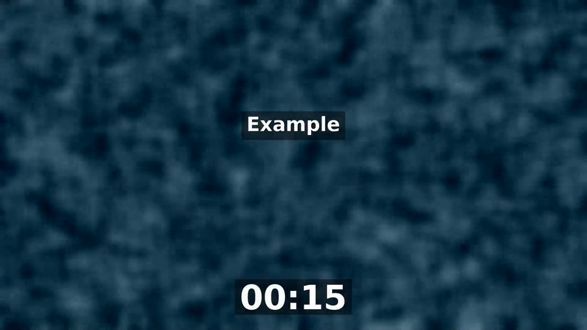
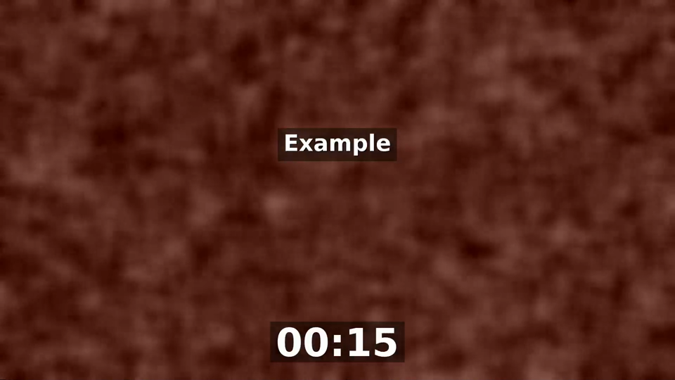
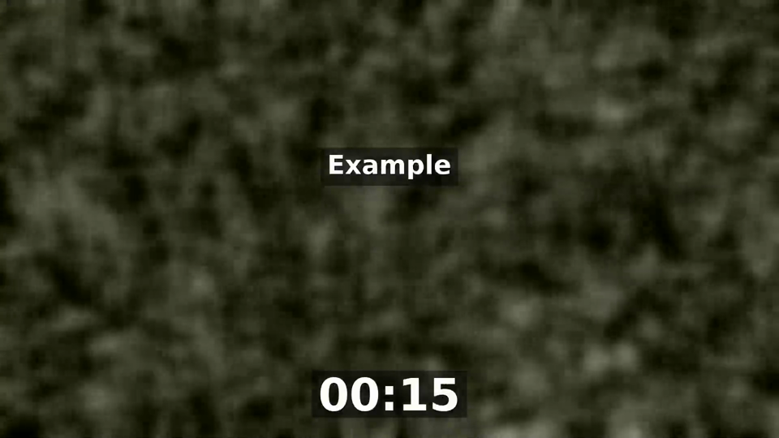
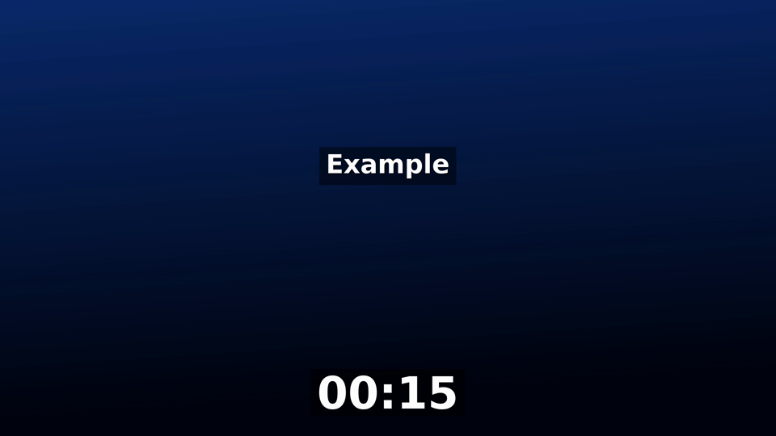
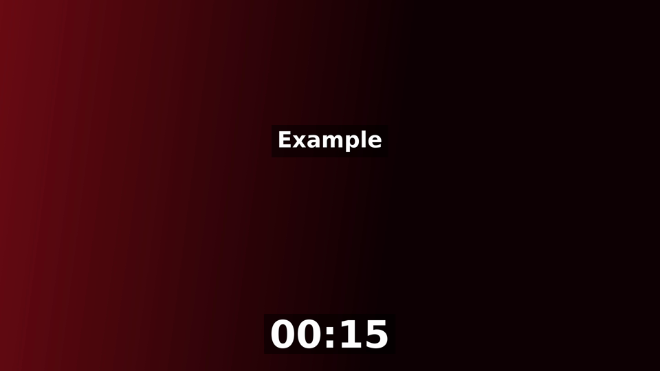
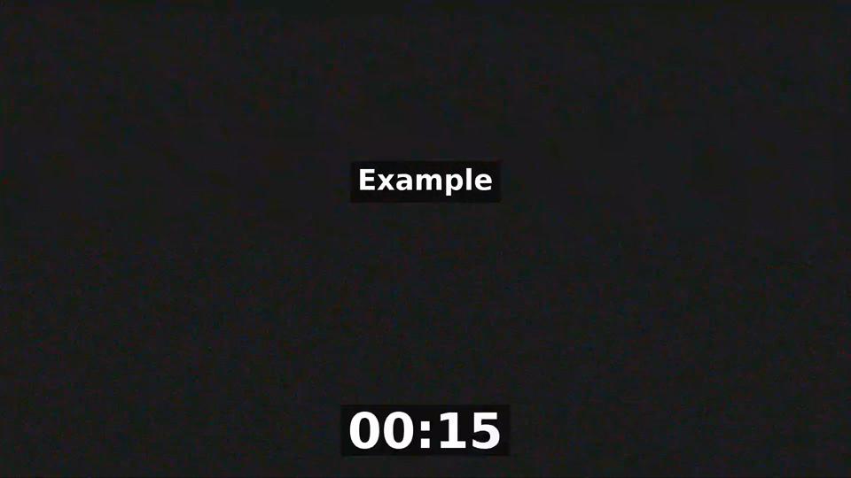
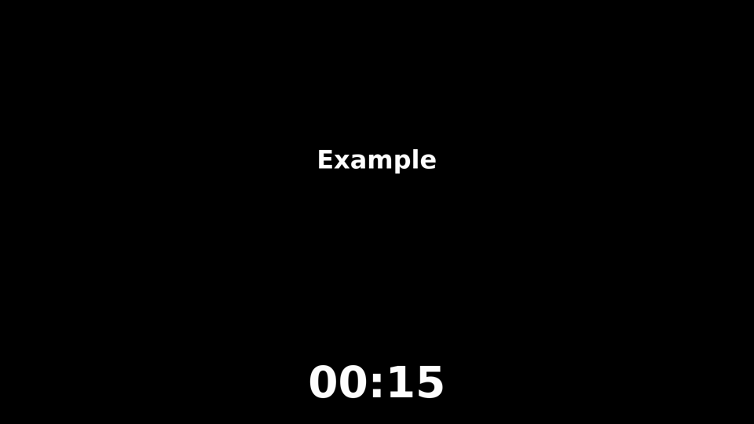

# ssp-channel-maker (ready to use)

Prepares films for the SMART STREAM PANEL feature "Create channel": uniform H.264/AAC encode on your NVIDIA GPU,
generated spots with your logo, and the `manifest.json` the panel needs. This repository IS the ready-made
folder, program included (one static binary for Ubuntu 24.04, x86_64); each version is also a tarball in **Releases**.

## English

1. Get the folder: `git clone https://github.com/michbott79-hue/ssp-channel-maker-dist.git ssp-channel-maker && cd ssp-channel-maker`
   (or download the tarball from the latest Release and extract it). Check the program: `sha256sum -c docs/ssp-channel-maker.sha256`.
2. Update later with `git pull`.
3. Build ffmpeg with NVIDIA NVENC once: `./install-ffmpeg-nvenc.sh --yes` (puts ffmpeg and ffprobe in `bin/`).
4. Check the machine: `./ssp-channel-maker doctor`.
5. Optional: put your own TMDB key in `config.toml` (`tmdb_key = "..."`, then `chmod 600 config.toml`).
6. Put your cleaned films in `in/`, your logo in `logos/`, and follow `docs/QUICKSTART.md` (full guide: `docs/GUIDE.md`).

## Italiano

1. Prendi la cartella: `git clone https://github.com/michbott79-hue/ssp-channel-maker-dist.git ssp-channel-maker && cd ssp-channel-maker`
   (oppure scarica il tarball dall'ultima Release ed estrailo). Controlla il programma: `sha256sum -c docs/ssp-channel-maker.sha256`.
2. Per aggiornare in seguito: `git pull`.
3. Compila ffmpeg con NVIDIA NVENC una volta sola: `./install-ffmpeg-nvenc.sh --yes` (mette ffmpeg e ffprobe in `bin/`).
4. Controlla il PC: `./ssp-channel-maker doctor`.
5. Facoltativo: metti la tua chiave TMDB in `config.toml` (`tmdb_key = "..."`, poi `chmod 600 config.toml`).
6. Metti i film puliti in `in/`, il logo in `logos/` e segui `docs/QUICKSTART.md` (guida completa: `docs/GUIDE.md`).

`example-spots/` has one sample spot (title "Example", 20 s countdown, no logo) for each built-in background: pick one with `--background NAME`.
In `example-spots/` trovi uno spot di esempio per ogni sfondo incluso: scegline uno con `--background NOME`.

Backgrounds (a still from each sample; the .mp4 files are in the same folder):

- `smoke1`: 
- `smoke2`: 
- `smoke3`: 
- `gradient-blue`: 
- `gradient-red`: 
- `grain`: 
- `black`: 

Your TMDB key is personal: never share it.
